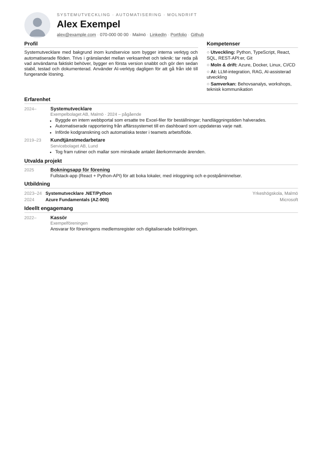
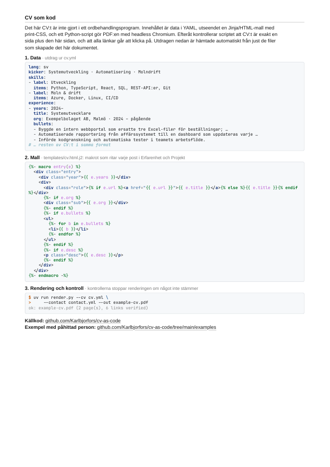
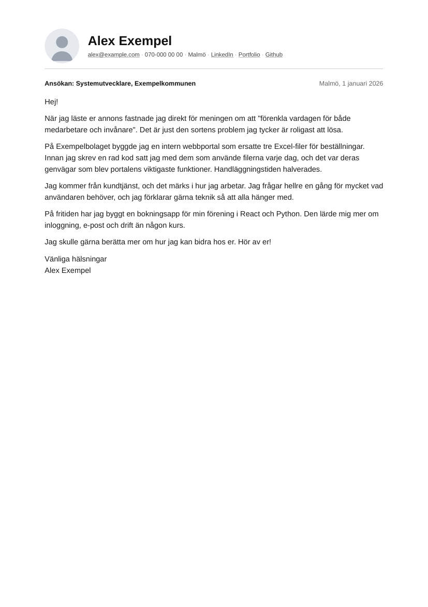

# CV som kod

Ett CV som byggs från **data + mall + kod** i stället för att redigeras för hand i ett
ordbehandlingsprogram. Innehållet ligger i YAML, utseendet i en Jinja/HTML-mall med print-CSS,
och ett Python-script gör en PDF av det med headless Chromium. Sedan kontrollerar scriptet att
resultatet håller måttet: exakt en sida och klickbara länkar. Samma motor gör även
[personliga brev](#personligt-brev) med samma sidhuvud.

| Sida 1: CV:t | Sida 2: "CV som kod" (valfri) |
|---|---|
|  |  |

Exemplet ovan är en påhittad person ([`examples/`](examples/)). Mitt riktiga CV renderas med
samma kod, men innehåll, kontaktuppgifter och foto ligger privat och finns inte i det här repot.

## Varför?

- **Ett CV per ansökan utan copy-paste.** Varje annons får en egen `cv.yml` med anpassad profil
  och utvalda erfarenheter. Mallen och kontaktuppgifterna delas.
- **AI skriver text, kod gör resten.** En AI-agent kan skriva en anpassad `cv.yml`, men den ska inte
  "rita" PDF:er. Layout, rendering och kontroller är deterministisk kod som alltid ger samma resultat.
- **Färre tokens.** AI:n skriver bara innehållet. För ett riktigt CV i det här formatet är
  `cv.yml` cirka 5 kB (~1 500 tokens), mot cirka 20 kB (~6 000 tokens) för motsvarande färdiga
  HTML. Ett foto som base64 skulle ensamt kosta tiotusentals tokens om AI:n hanterade det.
  Ändringar blir en redigering i YAML i stället för en omskrivning av hela dokumentet. Om något är
  fel säger scriptet exakt vad, så AI:n behöver inte granska en bild av PDF:en för att hitta felet.
  Mall, rendering, kodsida och kontroller är återanvändbar kod och kostar inga tokens alls.
- **Kontroller i stället för att hoppas.** Ett CV som råkat bli två sidor, eller där
  LinkedIn-länken bara är text, stoppas innan det skickas.
- **Versionshanterat.** Varje ändring syns i Git, och gamla CV:n kan återskapas exakt.

## Snabbstart

Kräver [uv](https://docs.astral.sh/uv/) och Chromium eller Google Chrome.

```bash
uv run render.py --cv examples/cv.yml --contact examples/contact.yml --out out/cv.pdf
# ok: out/cv.pdf (2 page(s), 6 links verified)

uv run render.py --letter examples/letter.md --contact examples/contact.yml --out out/letter.pdf
# ok: out/letter.pdf (1 page(s), 4 links verified)
```

`render.py` är ett fristående script med inbyggd beroendedeklaration
([PEP 723](https://peps.python.org/pep-0723/)). `uv` installerar `jinja2`, `pyyaml` och `pygments` automatiskt
i en isolerad miljö, så du behöver ingen virtualenv eller `requirements.txt`.

| Flagga | Betydelse |
|---|---|
| `--cv FIL` | CV-innehållet (`cv.yml`) |
| `--letter FIL` | Ett personligt brev (`letter.md`) i stället för ett CV |
| `--contact FIL` | Kontaktuppgifter (`contact.yml`) |
| `--out FIL` | Var PDF:en hamnar |
| `--photo FIL` | Porträtt (jpg/png/svg). Går före `photo:` i `contact.yml` |
| `--template FIL` | Annan mall än `templates/cv.html.j2` (eller `letter.html.j2` med `--letter`) |
| `--html` | Spara även den renderade HTML:en bredvid PDF:en (bra för felsökning) |
| `--allow-multipage` | Stäng av kravet på en sida |

Webbläsaren hittas automatiskt (`chromium`, `chromium-browser`, `google-chrome-stable`,
`google-chrome`), eller anges med `CHROME=/sökväg/till/webbläsare`.

## Dataformat

Datan är uppdelad i två filer med flit. Kontaktuppgifter ändras sällan och är personliga, medan
CV-innehållet skrivs om för varje ansökan.

### `contact.yml`

```yaml
name: Alex Exempel
email: alex@example.com        # blir en mailto:-länk
phone: 070-000 00 00           # valfri
location: Malmö                # valfri
photo: avatar.svg              # valfri, sökväg relativt contact.yml
links:                         # visas i den här ordningen i sidhuvudet
  - label: LinkedIn
    url: https://www.linkedin.com/in/example
  - label: Github
    url: https://github.com/example
```

Varje `url`, plus `mailto:` för e-posten, **måste** finnas som klickbar länk i den färdiga PDF:en,
annars avbryts renderingen.

### `cv.yml`

```yaml
lang: sv                       # sv | en, styr rubrikerna
kicker: Systemutveckling · Automatisering   # liten rad ovanför namnet
profile: >-
  Löptext för profilen ...
skills:                        # högerspalten
  - label: Utveckling
    items: Python, TypeScript, SQL
experience:                    # poster: years, title, org?, bullets?, desc?, url?
  - years: 2024–
    title: Systemutvecklare
    org: Exempelbolaget AB, Malmö
    bullets:
      - Byggde en intern webbportal ...
projects:                      # samma postformat som experience
  - years: 2025
    title: Bokningsapp
    url: https://example.com   # gör titeln klickbar
    desc: Kort beskrivning ...
education:                     # years, title, org
  - years: 2023–24
    title: Systemutvecklare .NET/Python
    org: Yrkeshögskola, Malmö
volunteer:                     # samma postformat som experience
  - years: 2022–
    title: Kassör
    desc: ...
source_page:                   # valfri sida 2, se nedan
  repo: https://github.com/<du>/cv-as-code
  intro: ...                   # valfri, annars standardtext för språket
```

Alla sektioner utom `profile` och `skills` är valfria och hoppas över om de saknas. Tips: sätt
citattecken runt punkter som innehåller `: ` (kolon + mellanslag), annars tolkar YAML dem som
nyckel/värde. Skriv årtal som `"2025"` om du vill vara säker på att de blir text.

## Så fungerar mallen

[`templates/cv.html.j2`](templates/cv.html.j2) är en vanlig HTML-sida med inbäddad CSS, skriven för
utskrift i stället för skärm:

- **`@page { size: A4; margin: 8mm 16mm; }`** styr pappersformat och marginaler. Chromiums
  `--print-to-pdf` respekterar detta, och med `--no-pdf-header-footer` försvinner webbläsarens
  datum och URL.
- **Typografi i `pt`**, inte `px`, så storlekarna motsvarar ett tryckt dokument (brödtext 8,4 pt).
- **CSS grid** för layouten: sidhuvud (foto + namn), en tvåspaltig topp (profil 1,9 fr,
  kompetenser 1 fr) och poster med en smal årtalskolumn och innehåll bredvid.
- **En Jinja-makro, `entry()`**, ritar alla poster i erfarenhet, projekt och ideellt engagemang.
  Därför har de samma format och samma valfria fält.
- **Autoescape är på**, så tecken som `&` och `<` i YAML-texten blir korrekt HTML.
- **Fotot bäddas in som base64** (`data:`-URI). HTML:en är då helt fristående, och PDF:en kan
  renderas utan nätverk eller lösa filer.
- **Rubrikerna översätts** via en liten tabell överst i mallen (`sv`/`en`).

### Lägga till en sektion

1. Lägg till en nyckel i `cv.yml`, t.ex. `certifications:` med samma postformat.
2. I mallen: lägg till nyckeln i loopen `` om den ska se
   ut som erfarenhet, eller skriv ett eget block.
3. Lägg till rubriken i översättningstabellen `t` för både `sv` och `en`.
4. Rendera med `--html` och öppna HTML-filen i webbläsaren för att justera CSS snabbt. Kör sedan
   utan flaggan för att få PDF och kontroller.

## Sida 2: "CV som kod"

Med `source_page:` i `cv.yml` lägger mallen till en andra sida som visar hur just det här CV:t
skapades:

1. **Data:** ett utdrag ur den `cv.yml` som användes (kicker, två kompetenser och första jobbet
   med tre punkter). Långa rader kortas med `…` så att de inte radbryts.
2. **Mall:** makrot `entry()` klipps ut direkt ur mallfilen.
3. **Rendering och kontroll:** kommandot och den rad scriptet skriver ut när kontrollerna gått
   igenom.
4. **Länkar** till repot och till `examples/`, och de kontrolleras också i PDF:en.

Utdragen genereras vid varje rendering från filerna som faktiskt används, så sidan kan aldrig
visa något annat än det som skapade dokumentet. Kommandot visar bara filnamn, aldrig lokala
sökvägar, och `contact.yml` visas inte alls. Syntaxfärgningen görs med
[Pygments](https://pygments.org/) med inbäddade stilar.

Med sida 2 påslagen förväntas PDF:en vara exakt **två** sidor: CV:t måste fortfarande få plats på
en, och kodsidan på en.

## Personligt brev

Med `--letter` i stället för `--cv` blir det ett brev på en sida med samma sidhuvud som CV:t:
foto, namn och klickbara kontaktlänkar. Brevet är vanlig text, så det är lätt att skriva och
redigera, både för en människa och en AI:

```markdown
---
subject: "Ansökan: Systemutvecklare, Exempelkommunen"   # valfritt, visas fetstilt ovanför texten
date: Malmö, 1 januari 2026                             # valfritt, visas till höger
lang: sv                                                # valfritt (sv | en)
---
Hej!

Varje stycke skiljs åt med en tom rad.
En enkel radbrytning behålls, som i hälsningsfrasen nedan.

Vänliga hälsningar
Alex Exempel
```

Frontmatter (mellan `---`) är valfritt. Texten escapas, så HTML i brevet visas som text och kan
inte ändra layouten. Samma kontroller gäller: exakt en sida och alla kontaktlänkar klickbara.
Sidhuvudet ligger i `templates/_header.html.j2` och delas av båda mallarna, så CV och brev alltid
ser ut att höra ihop.

[Exempelbrevet som PDF](examples/example-letter.pdf):



## Kontroller

Efter utskrift läser `render.py` PDF:en och kontrollerar:

| Kontroll | Hur | Varför |
|---|---|---|
| Exakt en sida (två med `source_page`, alltid en för brev) | Räknar `/Type /Page`-objekt i PDF:en | Rekryterare läser sida ett; en sida två som råkat uppstå ser slarvig ut |
| Klickbara länkar | Letar efter varje `url`, `mailto:` och länkarna på kodsidan som `/URI`-annotation | Länkar som bara är text går inte att klicka på i en PDF |

Kontrollerna läser PDF-bytes direkt och behöver inga extra verktyg. Om något fallerar listas varje
problem och scriptet avslutas med felkod 1, så det fungerar även i ett automatiserat flöde.

## Hur mallen används i vårt arbetsflöde

Repot är renderingssteget i **Jobbsökassistenten**, ett privat fritidsprojekt. Det är ett system av
AI-agenter som hjälper mig söka jobb, med en människa som fattar alla beslut. Flödet för en
ansökan:

```
 Annons                Profil (privat)            Skribent-agent             cv-as-code             Människa
 ─────────            ─────────────────          ──────────────             ───────────            ─────────
 JobTech-API   ──►    verifierade fakta,   ──►   skriver anpassad    ──►    render.py:      ──►    granskar,
 (Platsbanken)        erfarenheter,              cv.yml för just            mall + data            justerar,
 → annons.md          contact.yml, foto          den här annonsen           → PDF + kontroller     skickar själv
```

1. **Annonsen hämtas** från Arbetsförmedlingens öppna JobTech-API, med strukturerade fält som krav,
   sista ansökningsdag och ansökningslänk. Den sparas som markdown.
2. **Profilen** är en privat kunskapsbas med mina erfarenheter, skrivna och verifierade av mig. Där
   finns också `contact.yml` och foto. Ingen av den datan finns i det här repot.
3. **En skribent-agent** (Claude Code) matchar annonsens krav mot profilen och skriver en anpassad
   `cv.yml`. Regeln är att den **bara får använda fakta från profilen**: inga påhittade siffror,
   verktyg eller titlar. AI:n används för det som kräver omdöme och fri text, inget annat.
4. **`render.py` gör PDF:en och kontrollerar den.** Om CV:t blev två sidor eller en länk saknas
   misslyckas steget, och agenten får korta texten eller rätta datan och försöka igen. Det blir en
   enkel återkopplingsloop utan att någon människa behöver märka felet.
5. **En människa granskar och skickar.** Inget skickas automatiskt. Systemet tar fram underlag, men
   beslutet och ansökan är mina.

Uppdelningen gör att samma mall och samma kontroller gäller för varje ansökan, oavsett vilken
agent eller modell som skrev texten. Det gör det också lätt att jämföra olika AI-modeller på samma
annons, eftersom bara `cv.yml` skiljer sig.

### Personuppgifter och hemligheter

- Repot innehåller **bara kod, mall och påhittad exempeldata**.
- Riktiga `contact.yml`, foto och CV-innehåll ligger i en privat katalog utanför repot och skickas
  in med `--cv` och `--contact`.
- `.gitignore` stoppar vanliga misstag: `out/`, `private/`, `*.local.yml` och bilder utanför
  `examples/`.

## Felsökning

| Problem | Lösning |
|---|---|
| `no Chromium/Chrome found` | Installera Chromium, eller sätt `CHROME=/sökväg/till/chrome` |
| `expected 1 page(s), got 2` (eller `2 … got 3`) | Korta texten, ta bort en punkt, en äldre post eller ett stycke i brevet. Rendera med `--html` för att se var det tar slut |
| `link missing or not clickable` | Kontrollera att mallen ritar länken som `<a href=...>` och att URL:en i YAML är exakt samma |
| `has no text` | Brevfilen är tom, eller innehåller bara frontmatter |
| `cannot read ... could not find expected ':'` | YAML-syntaxfel. Sätt citattecken runt texten på raden som anges |
| Fel typsnitt i PDF:en | Mallen använder Arial/Helvetica och faller tillbaka på systemets sans-serif. Installera t.ex. `ttf-liberation` för samma metrik som Arial |

## Licens

MIT, se [LICENSE](LICENSE).
